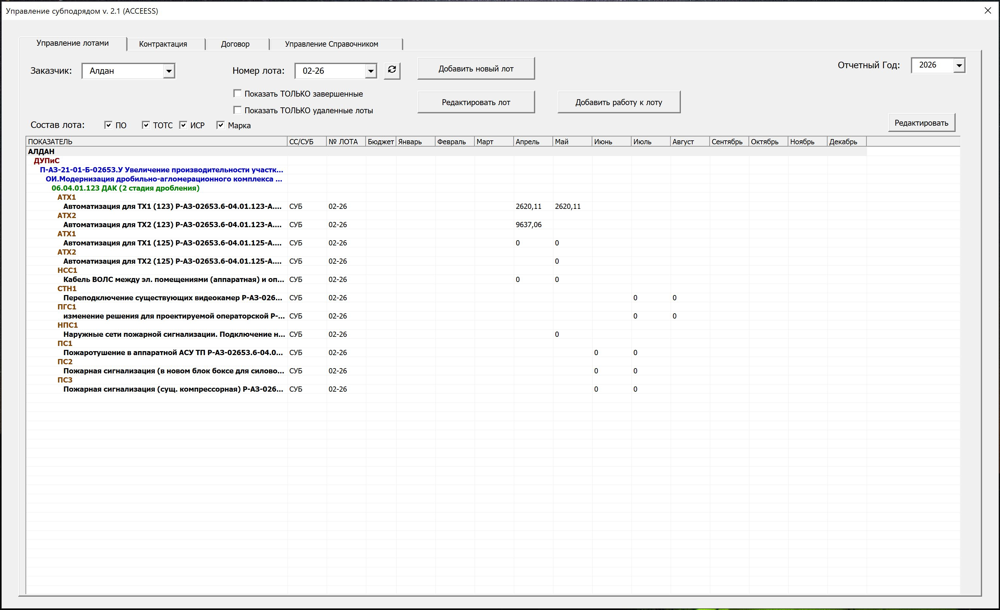
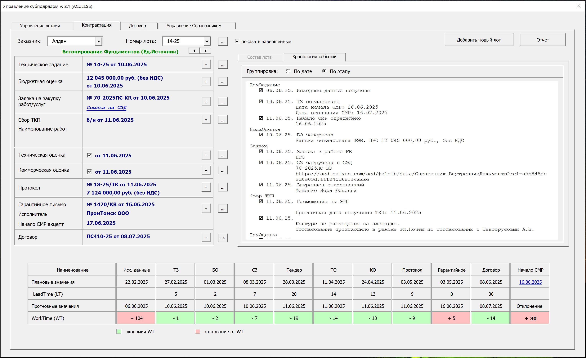
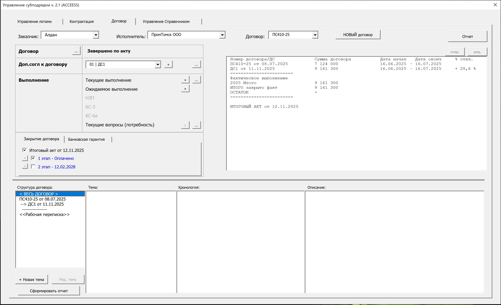
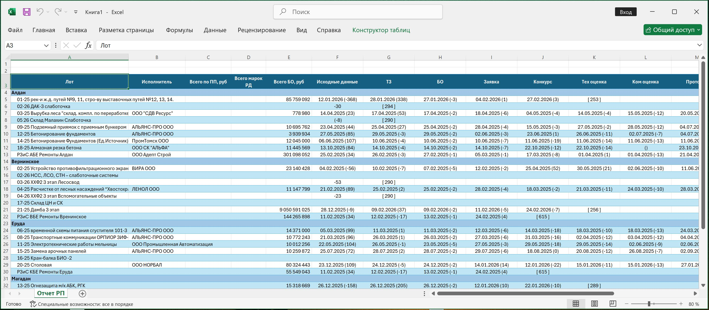

# АРМ "Управление субподрядом"

**Автоматизация полного цикла субподрядных работ в строительной компании**

## О проекте
Данное ПО - автоматизированное рабочее место (АРМ) для отдела управление субподрядом крупной строительной организации. Система охватывает полный жизненный цикл субподрядных работ: от отбора позиций производственной программы и формирования лотов до проведения 9 этапов контрактации, заключения и сопровождения договоров, а также формирования сводной управленческой отчетности для руководства. Разработано одним специалистом за 5 месяцев и внедрено в операционную деятельность.

**Моя роль**: единственный разработчик полного цикла — анализа требований, проектирование БД, UI/UX, реализация, внедрение, поддержка.

## Решенные бизнес-проблемы
- **Хаотичное хранение данных** --> единая база данных SQL Server + структурированный файловый архив на сетевом диске
- **Потеря контроля над строками** --> автоматический расчет плановых дат этапов (LeadTime) и цветовая индикация отставаний. Ни один лот не забыт.
- **Непрозрачность процесса** --> полная хронология событий (вехи, проблемы, решения) по каждому лоту.
- **Управленческая отчетность** --> мгновенная выгрузка сводок в Excel для руководства по нажатию соответствующей кнопки.

## Бизнес-ценность
- **Прозрачность**: каждый лот и договор на контроле, ни один этап не потерян.
- **Скорость**: отчётность для руководства — по кнопке (было — несколько часов).
- **Ритмичность**: автоматический расчёт плановых дат (LeadTime) и цветовая индикация отклонений.
- **Порядок**: единая БД + структурированный файловый архив на сетевом диске.

**Результат:** ритмичность контрактации, ускорение работы отдела, прозрачный контроль каждого этапа.

## Ключевые возможности
**1. Работа с производственной программой и лотами**
- Иеархическое отображение: СП --> узловой проект --> ТОТС/ИСР шифр --> марка чертежа --> ЛСР шифр
- Фильтрация работ "СС = собственные силы" / "СУБ = субподряд"
- Создание лотов с группировкой выбранных позиций и указанием объемов по 12 месяцев.
- Автоматическое создание папки лота на сетевом диске.
  
**2. Управление этапами контрактации (9 этапов)**
1. Техническое задание
2. Бюджетная оценка
3. Заявка на закупку (СЭД)
4. Сбор ТКП (тендер)
5. Техническая оценка
6. Коммерческая оценка (матрица)
7. Протокол
8. Гарантийное письмо
9. Договор
- Фиксация дат, сумм, номеров документов, ссылок на тендер/договор
- **Расчет LeadTime**: на основе даты начала СМР и нормативных длительностей (из таблицыLeadTime) строится плановый график. При вводе фактических дат система определяет текущий этап и прогнозирует оставшиеся сроки.
- **Цветовая индикация**: зеленный - опережение, красный - просрочка.
- Для каждого этапа на сетевом диске создается и закрепляется подпапка.

**3. Хронология событий и управление рисками**
- Автоматическая генерация системных событий при завершении этапов.
- Ручное добавление пользовательских событи: вехи, проблемы, задачи.
- Фильтрация по типу события и этапу.
- Хронология выводится в виде отчета с форматированием.

**4. Договорная работа**
- Учет договоров и дополнительных соглашений (ДС).
- Ежемесячная фиксация выполнения (акты КС-6а), автоматический пересчет остатка.
- Учет банковских гарантий (аванс,гарантийноеудержание) с контролем сроков продления.
- Иеархическая переписка: темы --> письма (входящие/исходящие/внутренние) с привязкой к договору/ДС.
- Для каждого договора и ДС на сетевом диске создается и закрепляется подпапка.

**5. Отчетность**
- **Сводка по всем лотам** (Excel): даты этапов, отклонения от LeadTime
- **Сводка по договорам/ДС** (Excel): суммы, выполнение, остатки, банковские гарантии.
- **Сводка по рабочей переписка в рамках договора** (Excel): вывод всех созданных тем и писем в рамках договора
- Отчет по хронологии событий по каждому лоту в отдельном окне

## Технологический стек
| Компонент | Технология |
|---------------|-----------------|
| Клиент | VBA (Microsoft Excel) c многооконными UserForms |
| Серверная СУБД | Microsoft SQL Server (корпоративная БД) |
| Локальная СУБД | Microsoft Access (для автономной работы/демо-версия) |
| Файловый архив | Сетевые папки NTFS, автоматическое создание/переименование |
| Отчеты | Excel (программная генерация с форматированием) |
| Интеграции | Внешняя СЭД (кликабельные ссылки) |

## Архитектура
- **Все изменения в БД фиксируются транзакционной записью create_date/user и update_date/user**.
- **Реализовано "мягкое удаление" (флаг deleted) с возможностью восстановления**.

## Скриншоты
*(см. папку `screenshots/`)*
<table>
  <tr>
    <td width="50%">
       
      <b>Рис. 1.</b> Главное окно — единое рабочее место
    </td>
    <td width="50%">
       
      <b>Рис. 2.</b> Карточка лота: расчёт LeadTime и индикация отклонений
    </td>
  </tr>
  <tr>
    <td width="50%">
       
      <b>Рис. 3.</b> Карточка договора: выполнение, остатки, банковские гарантии
    </td>
    <td width="50%">
       
      <b>Рис. 4.</b> Управленческая отчётность в Excel
    </td>
  </tr>
</table>

## Компетенции подтвержденные проектом
- Полный цикл разработки ПО: от сбора требований до внедрения.
- Проектирование реляционных БД (10+ таблиц, нормализация, сложные SQL-запросы).
- Программирование на VBA (многооконный UI, ADODB, работа с файловой системой, генерация Excel-отчётов).
- Архитектурное решение "клиент-сервер".
- Способность самостоятельно реализовать сложный проект в сжатые сроки

## Ключевые характеристики
- **Стек технологий:** VBA, SQL Server / Access, ADODB, FileSystemObject
- **Пользователи:** специалист по контрактации, специалист по договорам, начальник отдела, директор
- **Объем кода:** более 1200 строк основного модуля
- **Архитектура:** Клиент-сервер (форма VBA + БД), многопользовательский доступ

## Результаты внедрения
- Внедрено и используется отделом субподряда.
- Сокращение времени подготовки отчётности с часов до секунд.
- Прозрачный контроль этапов и сроков: ни один лот не теряется

## Скриншоты

*(см. `screenshots/`)*
- Главное окно с лотами и этапами
- Карточка лота с цветовой индикацией LeadTime
- Карточка договора с банковскими гарантиями
- Пример сводного отчёта в Excel
- Структура файлового архива

## Диаграммы

*(см. `diagrams/`)*
- Архитектура системы (компоненты + интеграции)
- Жизненный цикл лота (BPMN/Activity)
- ER-модель данных
- Дорожная карта проекта (Gantt)
